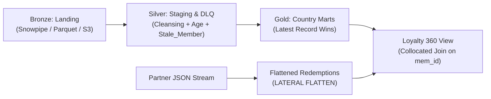

# SkyPoints Global Loyalty Data Platform
### Incubyte Data Engineer — Technical Assessment

An enterprise-grade, end-to-end data pipeline built for SkyPoints, an international airline loyalty program operating lounges and partner airline redemptions worldwide.

Designed to ingest and process **billions of records daily** across heterogeneous member profile feeds (pipe-delimited flat files, CSVs) and semi-structured partner mileage redemption feeds (JSON).

---

## 📋 Assessment Deliverables Matrix

| # | Deliverable | Description | Primary Implementation Files |
|:---:|:---|:---|:---|
| **1** | **Table Queries & DDL** | DDL for raw/landing tables, staging table, and country-specific target tables. | [`sql/snowflake/01_raw_landing_ddl.sql`](file:///e:/New%20folder%20(2)/sql/snowflake/01_raw_landing_ddl.sql)<br/>[`sql/snowflake/02_staging_ddl.sql`](file:///e:/New%20folder%20(2)/sql/snowflake/02_staging_ddl.sql)<br/>[`sql/snowflake/03_country_target_ddl.sql`](file:///e:/New%20folder%20(2)/sql/snowflake/03_country_target_ddl.sql)<br/>[`sql/local_sqlite/schema.sql`](file:///e:/New%20folder%20(2)/sql/local_sqlite/schema.sql) |
| **2** | **Staging & Derived Columns** | Staging load with derived `Age` (computed from DOB) and `Stale_Member` flag (days since Flight_Date > 90). | [`src/date_utils.py`](file:///e:/New%20folder%20(2)/src/date_utils.py)<br/>[`src/transformation.py`](file:///e:/New%20folder%20(2)/src/transformation.py)<br/>[`sql/snowflake/02_staging_ddl.sql`](file:///e:/New%20folder%20(2)/sql/snowflake/02_staging_ddl.sql) |
| **3** | **Country Split & 'Latest Record Wins'** | Split members into per-country target tables (`Table_India`, `Table_USA`, etc.) enforcing latest-record-wins when members relocate. | [`src/country_router.py`](file:///e:/New%20folder%20(2)/src/country_router.py)<br/>[`sql/snowflake/04_transform_country_split.sql`](file:///e:/New%20folder%20(2)/sql/snowflake/04_transform_country_split.sql) |
| **4** | **JSON Redemption Flattening & Joins** | Flatten semi-structured partner JSON feeds into relational model and join back to member profiles (Loyalty 360). | [`src/ingestion.py`](file:///e:/New%20folder%20(2)/src/ingestion.py)<br/>[`src/analytics.py`](file:///e:/New%20folder%20(2)/src/analytics.py)<br/>[`sql/snowflake/05_json_redemptions_flatten.sql`](file:///e:/New%20folder%20(2)/sql/snowflake/05_json_redemptions_flatten.sql) |
| **5** | **Data Validations & DQ Framework** | Mandatory field checks, key uniqueness, chronology rules, and Dead Letter Queue (DLQ) catching dirty dates (e.g. `2021-13-13`). | [`src/validator.py`](file:///e:/New%20folder%20(2)/src/validator.py)<br/>[`sql/snowflake/06_data_quality_checks.sql`](file:///e:/New%20folder%20(2)/sql/snowflake/06_data_quality_checks.sql) |
| **6** | **Live Demonstration & Test Suite** | Turnkey CLI demonstration script and automated test suite with 100% test pass rate. | [`run_demo.py`](file:///e:/New%20folder%20(2)/run_demo.py)<br/>[`tests/`](file:///e:/New%20folder%20(2)/tests/) |

---

## 🚀 Quick Start (Zero External Dependencies)

The pipeline is self-contained and executes using standard Python without requiring external cloud accounts or package installations:

### 1. Run the Live Demonstration
```bash
python run_demo.py
```
This executes the pipeline end-to-end:
- Ingests raw flat files and JSON feeds.
- Computes `Age` and `Stale_Member` flags in staging.
- Screens data quality and quarantines dirty rows (month 13 error, missing mandatory fields) into the Dead Letter Queue.
- Splits members into country tables (`Table_India`, `Table_USA`, etc.) and proves "Latest Record Wins" when Elena moves from the USA to India.
- Flattens partner JSON redemptions and outputs Member Loyalty 360 analytics.

### 2. Run the Automated Test Suite
```bash
python -m unittest discover tests -v
```
Runs 20 automated tests across date parsing, validator edge cases, country routing, and end-to-end integration.

---

## 🏛️ Billion-Record Scalability Architecture

To process **billions of records daily**, the production architecture leverages the Medallion Pattern on modern cloud data warehouses (Snowflake / Databricks / Spark):



1. **Ingestion & Micro-Partitioning**:
   - Files are partitioned in object storage (e.g. `s3://skypoints-lake/raw/year=2026/month=10/day=31/`).
   - Snowflake clustering keys (`CLUSTER BY (COUNTRY, MEM_ID)`) avoid full-table scans.
2. **Dead Letter Queue (DLQ)**:
   - Malformed records (e.g. `2021-13-13`) are routed to `DLQ_REJECTED_RECORDS` rather than crashing the ingestion stream.
3. **Latest Record Wins Deduplication**:
   - Implemented via distributed window functions:
     `ROW_NUMBER() OVER (PARTITION BY MEM_ID ORDER BY COALESCE(FLIGHT_DT, ENROLL_DT) DESC, _INGESTION_TIMESTAMP DESC)`
4. **Collocated Joins**:
   - Both Member dimensions and Redemption fact tables are clustered on `MEM_ID`, enabling distributed merge joins without expensive network shuffles.

For full architectural details, see [docs/ARCHITECTURE.md](file:///e:/New%20folder%20(2)/docs/ARCHITECTURE.md).

---

## 📂 Project Directory Layout

```
skypoints-loyalty-pipeline/
├── run_demo.py                      # Turnkey live demonstration script
├── README.md                        # Master project documentation
├── data/
│   ├── raw/
│   │   ├── skypoints_members_20240115_08000000.dat      # Assessment flat file sample
│   │   ├── skypoints_members_dirty_20240115_09000000.csv# Dirty feed with edge-cases
│   │   ├── skypoints_members_relocation_20240116_10000000.dat # Member relocation feed
│   │   └── skypoints_redemptions_20240115_12000000.json # Partner JSON redemption feed
│   └── output/
│       └── skypoints_loyalty.db     # SQLite analytical database generated on execution
├── sql/
│   ├── snowflake/                   # Production Snowflake DDL & Procedures
│   │   ├── 01_raw_landing_ddl.sql   # Bronze raw landing & Snowpipe
│   │   ├── 02_staging_ddl.sql       # Silver staging + Age + Stale_Member derivation
│   │   ├── 03_country_target_ddl.sql# Gold country target tables (Table_India, etc.)
│   │   ├── 04_transform_country_split.sql # Latest record wins & country dispatch
│   │   ├── 05_json_redemptions_flatten.sql# LATERAL FLATTEN & Loyalty 360 joins
│   │   └── 06_data_quality_checks.sql# DLQ table & screening procedures
│   └── local_sqlite/
│       ├── schema.sql               # ANSI/SQLite DDL for local execution
│       └── views_and_queries.sql    # Analytical joins & views
├── src/
│   ├── config.py                    # Constants, mappings, and configuration
│   ├── date_utils.py                # Multi-format date parsing, Age & Stale computation
│   ├── validator.py                 # Data validation & anomaly detection
│   ├── ingestion.py                 # Flat file and JSON feed parsers
│   ├── transformation.py            # Enrichment & latest-record-wins deduplication
│   ├── country_router.py            # Per-country table routing & relocation sync
│   ├── analytics.py                 # Loyalty 360 joins & redemption aggregation
│   └── pipeline.py                  # Master pipeline orchestrator
├── tests/
│   ├── test_date_utils.py           # Tests for date parsing and edge cases
│   ├── test_validator.py            # Tests for DQ rules, mandatory nulls, bad dates
│   ├── test_transformation.py       # Tests for Age, Stale_Member, and deduplication
│   ├── test_json_parser.py          # Tests for JSON feed flattening
│   └── test_pipeline_e2e.py         # End-to-end integration tests
└── docs/
    ├── ARCHITECTURE.md              # Billion-record Big Data scalability architecture
    ├── DATA_DICTIONARY.md           # Field specifications, types, and quality rules
    └── INTERVIEW_DEMO_GUIDE.md      # Candidate interview script & walkthrough guide
```

---

## 🧪 Test Suite Coverage

All 20 tests pass out of the box:
```text
test_compute_age (test_date_utils.TestDateUtils) ... ok
test_is_stale_member (test_date_utils.TestDateUtils) ... ok
test_parse_iso_yyyy_mm_dd (test_date_utils.TestDateUtils) ... ok
test_parse_missing_leading_zero (test_date_utils.TestDateUtils) ... ok
test_parse_null_and_empty (test_date_utils.TestDateUtils) ... ok
test_parse_standard_yyyymmdd (test_date_utils.TestDateUtils) ... ok
test_parse_with_leading_zero (test_date_utils.TestDateUtils) ... ok
test_reject_invalid_date_month_13 (test_date_utils.TestDateUtils) ... ok
test_parse_redemptions_json (test_json_parser.TestJsonParser) ... ok
test_end_to_end_pipeline (test_pipeline_e2e.TestPipelineE2E) ... ok
test_enrich_derived_columns (test_transformation.TestTransformation) ... ok
test_latest_record_wins_fallback_to_enrollment_date (test_transformation.TestTransformation) ... ok
test_latest_record_wins_when_member_moves_country (test_transformation.TestTransformation) ... ok
test_chronology_dob_in_future (test_validator.TestValidator) ... ok
test_chronology_flight_before_enrollment (test_validator.TestValidator) ... ok
test_domain_violation_flag (test_validator.TestValidator) ... ok
test_invalid_enrollment_date_month_13 (test_validator.TestValidator) ... ok
test_missing_mandatory_member_id (test_validator.TestValidator) ... ok
test_missing_mandatory_name (test_validator.TestValidator) ... ok
test_valid_record (test_validator.TestValidator) ... ok

----------------------------------------------------------------------
Ran 20 tests in 0.233s

OK
```

---

## 🧑‍🏫 Interview Demonstration Guide

For a step-by-step presentation script, talking points, and answers to anticipated technical questions, see [docs/INTERVIEW_DEMO_GUIDE.md](file:///e:/New%20folder%20(2)/docs/INTERVIEW_DEMO_GUIDE.md).
