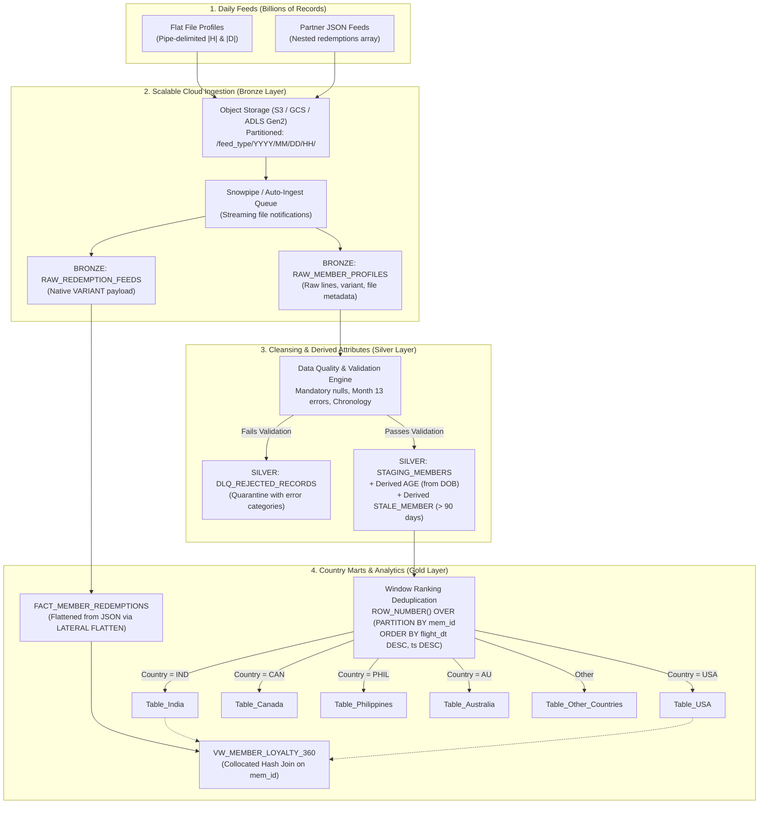

# SkyPoints Big Data Architecture: Ingestion & Processing at Billion-Record Scale

## 1. Executive Summary

The SkyPoints loyalty platform receives **two daily data feeds** that must scale to **billions of records every day**:
1. **Flat File Member Profile Data**: Daily snapshots containing member details, contact attributes, flight activity, and country assignments.
2. **Semi-Structured JSON Redemption Feed**: Nested transaction streams from partner airlines recording mileage burn activities across lounges and partner carriers.

This document details the enterprise production architecture designed to meet this scale, ensuring:
- **Sub-hour SLA** end-to-end processing across billions of records.
- **Idempotency and Zero Data Loss** with Bronze-Silver-Gold Medallion design.
- **Strict Data Quality** via an automated Dead Letter Queue (DLQ) quarantine rather than pipeline halts.
- **Deterministic Deduplication** enforcing the **"Latest Record Wins"** rule across country migrations.

---

## 2. High-Level Architecture (Medallion Pattern)



---

## 3. Handling Billions of Records: Scalability Mechanics

### A. Storage Architecture & Ingestion Optimization
- **File Format & Compression**: Source files are staged in cloud object storage (Amazon S3 / Google Cloud Storage) split into 100MB–250MB chunks compressed with `Snappy` or `GZIP`.
- **Snowpipe Continuous Ingestion**: Instead of one monolithic batch `COPY INTO`, files are ingested incrementally as they land in cloud storage via Amazon SNS/SQS event notifications into Snowflake.
- **External Stages & Hive Partitioning**:
  `s3://skypoints-lake/raw/member_profiles/year=2026/month=10/day=31/hour=20/part_0001.gz`
  Enables metadata pruning so compute engines never scan irrelevant days or partitions.

### B. Micro-Partitioning & Clustering Strategy
At billion-record scale, Snowflake's automatic micro-partitioning is enhanced with explicit clustering keys:
```sql
-- Staging Table: Clustered by Country and Member ID for fast filtering and deduplication
ALTER TABLE SILVER_STAGING.STAGING_MEMBERS CLUSTER BY (COUNTRY, MEM_ID);

-- Redemption Fact: Clustered on MEMBER_ID and TXN_DATE for fast collocated joins
ALTER TABLE GOLD_MARTS.FACT_MEMBER_REDEMPTIONS CLUSTER BY (MEMBER_ID, TXN_DATE);
```

### C. "Latest Record Wins" Deduplication Logic
To achieve maximum throughput when processing billions of records, deduplication is executed with distributed window functions:
```sql
WITH ranked_staging AS (
    SELECT 
        *,
        ROW_NUMBER() OVER (
            PARTITION BY MEM_ID 
            ORDER BY 
                COALESCE(FLIGHT_DT, ENROLL_DT) DESC,
                _INGESTION_TIMESTAMP DESC
        ) AS rn
    FROM SILVER_STAGING.STAGING_MEMBERS
)
SELECT * FROM ranked_staging WHERE rn = 1;
```
When a member moves countries (e.g. from USA to India):
- The member's latest record is inserted into `TABLE_INDIA`.
- Any existing record in `TABLE_USA` is invalidated or purged via an atomic cross-table synchronization merge.
- In Snowflake at scale, maintaining a unified master table `DIM_MEMBERS_UNIFIED` clustered by `(COUNTRY, MEM_ID)` with secure country views (`VW_TABLE_INDIA`, `VW_TABLE_USA`) provides maximum performance and zero cross-table lock contention.

### D. Semi-Structured JSON Flattening at Scale
Nested JSON arrays in `RAW_REDEMPTION_FEEDS` are parsed natively in Snowflake using `LATERAL FLATTEN`:
```sql
SELECT 
    f.RAW_PAYLOAD:member_id::STRING AS MEMBER_ID,
    TO_DATE(f.RAW_PAYLOAD:feed_date::STRING, 'YYYYMMDD') AS FEED_DATE,
    r.value:txn_id::STRING AS TXN_ID,
    TO_DATE(r.value:txn_date::STRING, 'YYYYMMDD') AS TXN_DATE,
    r.value:partner::STRING AS PARTNER,
    r.value:miles_redeemed::NUMBER(12, 0) AS MILES_REDEEMED,
    r.value:status::STRING AS STATUS
FROM BRONZE_LANDING.RAW_REDEMPTION_FEEDS f,
LATERAL FLATTEN(input => f.RAW_PAYLOAD:redemptions) r;
```
- In an Apache Spark / Databricks environment, this translates to `spark.read.json()` followed by `df.select(..., explode($"redemptions").as("r"))`.

### E. Collocated Joins (Member Profiles + Redemptions)
When joining billions of redemption transactions back to member profiles:
- Both tables are clustered on `MEMBER_ID`.
- This ensures Snowflake or Spark performs a **collocated merge-join** without requiring an expensive distributed network shuffle across compute nodes.

---

## 4. Data Quality & Anomaly Quarantine (DLQ)

A critical failure point in high-throughput pipelines is unexpected schema drift or dirty source rows (such as month 13 dates or NULL mandatory fields). Halting the pipeline blocks business operations.

Instead, the SkyPoints architecture implements an **automated Dead Letter Queue (DLQ)** pattern:
- **Valid Rows**: Flow straight into `SILVER_STAGING` and `GOLD_MARTS`.
- **Invalid Rows**: Automatically isolated into `DLQ_REJECTED_RECORDS` along with metadata:
  - `ERROR_CATEGORY`: `MANDATORY_NULL`, `INVALID_DATE`, `CHRONOLOGY_ERROR`, `DOMAIN_VIOLATION`
  - `ERROR_FIELD`: `enroll_dt`, `name`, `mem_id`, `dob`, `flight_dt`
  - `ERROR_MESSAGE`: Exact descriptive message (e.g., `"Invalid month: 13 in date '2021-13-13'"`)
  - `RAW_RECORD`: Full unparsed raw line for replaying after upstream fixes.
